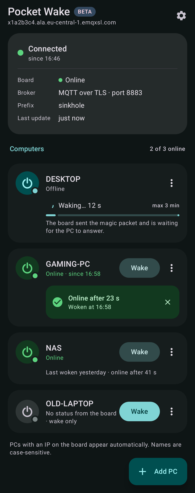
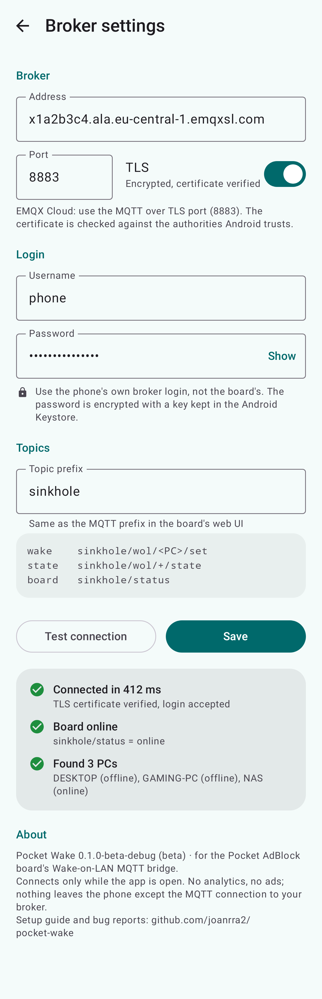

# Pocket Wake


[](https://github.com/joanrra2/pocket-wake/actions/workflows/build.yml)

> **Beta.** Pocket Wake works end to end, but it's new: expect rough edges, and please
> report problems in [Issues](https://github.com/joanrra2/pocket-wake/issues). Settings may
> need re-entering between beta versions.

One-tap Wake-on-LAN for your PCs, from anywhere, through the MQTT bridge of a
[Pocket AdBlock](https://github.com/joanrra2/pocket-adblock) board.

Pick a PC, tap **Wake**, and watch it come up: the board sends the magic packet on your
home network, checks that the PC answers, and the app shows **Online after 23 s**.

<p>
  
  
  
</p>

## What it shows

- **Connection card**: connected / reconnecting / why it can't connect (wrong password,
  untrusted certificate, wrong port...), whether the **board** is online (its MQTT last
  will), the transport (TLS, port), the topic prefix and when the last update arrived.
- **One card per PC** with a green / grey dot. PCs that have an IP on the board appear by
  themselves; PCs without an IP can be added by name (case-sensitive, e.g. `OFFICE-PC`).
- **Wake progress**: "Waking… 12 s" with a 3-minute progress bar, then
  "Online after N s", "Already online", "Magic packet sent" (PCs the board can't check),
  or a hint when nothing answers after 3 minutes.
- **Last wake** per PC ("Last woken yesterday · online after 41 s"), kept on the phone.
- **Test connection** in settings checks the login and TLS, whether the board is online
  and lists the PCs it reports, before you save.

## Privacy and permissions

- Only the `INTERNET` permission. No analytics, no ads, no trackers, no background
  service: the app connects only while it is open and disconnects when you leave it.
- The broker password is encrypted (AES-256-GCM) with a key held in the Android Keystore.
  App backups are disabled.
- TLS is verified against Android's trusted certificate authorities with hostname
  checking. There is no "accept any certificate" option.

## Setup

**Step-by-step guide: [docs/SETUP.md](docs/SETUP.md)**. It covers the PC (BIOS, Windows),
the broker (EMQX Cloud Serverless with separate logins for the board and the phone), the
board's web UI, the app, and troubleshooting.

In short:

1. **PC**: wired Ethernet, Wake-on-LAN on in BIOS/UEFI and the network adapter, Windows
   fast startup off.
2. **Broker**: create a TLS broker and **two logins**, one for the board and one for the phone.
3. **Board** (`http://sinkhole.local/`): *Settings → Remote wake (MQTT)*: Broker URI
   `mqtts://<broker>:8883`, the board login, prefix `sinkhole`; restart. Then
   *Wake → Add a computer* with its name, MAC and (for the online dot) its IP.
4. **App**: *Set up broker*: broker address (host only), port 8883, TLS on, the **phone**
   login, the same prefix. *Test connection*, *Save*, then **Wake**.

### Topics used

| Topic | Direction | Payload |
|---|---|---|
| `<prefix>/wol/<name>/set` | app → board | `1` (any payload wakes `<name>`; QoS 1, not retained) |
| `<prefix>/wol/<name>/state` | board → app | `online` / `offline` (retained; only PCs with an IP) |
| `<prefix>/status` | board → app | `online` / `offline` (retained, last will) |

Problems? See [Troubleshooting](docs/SETUP.md#troubleshooting).

## Install

- **Debug builds**: every push builds `pocket-wake-debug-<n>`, under *Actions → Build →
  Artifacts* (unzip it to get the APK).
- **Releases**: tags `v*` publish a signed APK on the *Releases* page. Beta tags such as
  `v0.1.0-beta.1` are marked as pre-releases.

Allow "Install unknown apps" for your browser or file manager when Android asks.
Debug and release builds install side by side (the debug one is "Pocket Wake (debug)").

## Build

Requirements: JDK 17+ (21 recommended) and the Android SDK (platform 37).

```bash
./gradlew testDebugUnitTest assembleDebug
```

The APK is at `app/build/outputs/apk/debug/app-debug.apk`. To install it on a phone with
USB debugging enabled:

```bash
adb install -r app/build/outputs/apk/debug/app-debug.apk
```

Other tasks:

```bash
# End-to-end MQTT test against the public test broker broker.emqx.io (random topics, cleaned up afterwards)
POCKETWAKE_IT=1 ./gradlew testDebugUnitTest --tests '*BrokerIntegrationTest*'

# Re-render the README screenshots (docs/screenshots) with Robolectric
./gradlew recordRoborazziDebug

# Release APK (unsigned unless the signing variables below are set)
./gradlew assembleRelease
```

### Release signing

Signing keys are never stored in the repository. The release build reads them from
environment variables, which the GitHub workflow fills from repository secrets:

| Secret | Value |
|---|---|
| `POCKETWAKE_KEYSTORE_BASE64` | your upload/release keystore (`.jks`), base64-encoded |
| `POCKETWAKE_KEYSTORE_PASSWORD` | keystore password |
| `POCKETWAKE_KEY_ALIAS` | key alias |
| `POCKETWAKE_KEY_PASSWORD` | key password |

Create the keystore yourself (for example with `keytool -genkeypair -v -keystore
release.jks -keyalg RSA -keysize 4096 -validity 10000 -alias pocketwake`), keep a backup
somewhere safe (losing it means users must uninstall to update), and add the secrets
under *Settings → Secrets and variables → Actions*. Base64 for the first secret:
`base64 -w0 release.jks` (Linux) or
`[Convert]::ToBase64String([IO.File]::ReadAllBytes("release.jks"))` (PowerShell).

Then push a tag:

```bash
git tag v0.1.0-beta.1 && git push origin v0.1.0-beta.1
```

To sign locally instead, set `POCKETWAKE_KEYSTORE_FILE` (a path) and the three
password/alias variables before `./gradlew assembleRelease`.

## How it works

- Kotlin, Jetpack Compose (Material 3, dynamic colour on Android 12+), minSdk 26.
- MQTT 3.1.1 with the [HiveMQ MQTT Client](https://github.com/hivemq/hivemq-mqtt-client)
  (Apache-2.0); reconnects with backoff (1 → 30 s) on network errors, stops on login or
  certificate errors.
- The connection follows the app's foreground state (`ProcessLifecycleOwner`), so rotating
  the phone doesn't reconnect.
- Code layout: `core/` pure Kotlin (topics, the host and wake state machine, formatting;
  unit-tested), `mqtt/` broker session and connection test, `data/` settings and the
  Keystore-encrypted password, `ui/` Compose screens.

See [ROADMAP.md](ROADMAP.md) for what's planned next.
