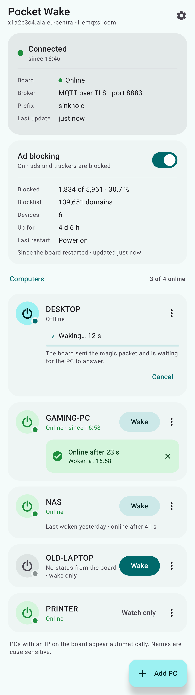
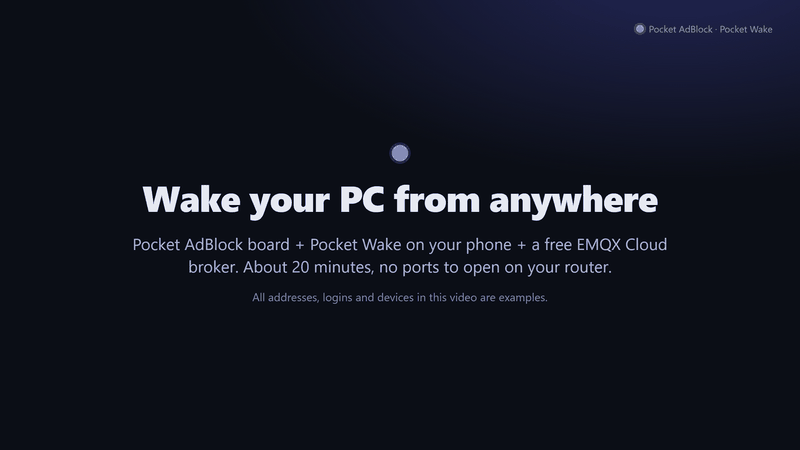
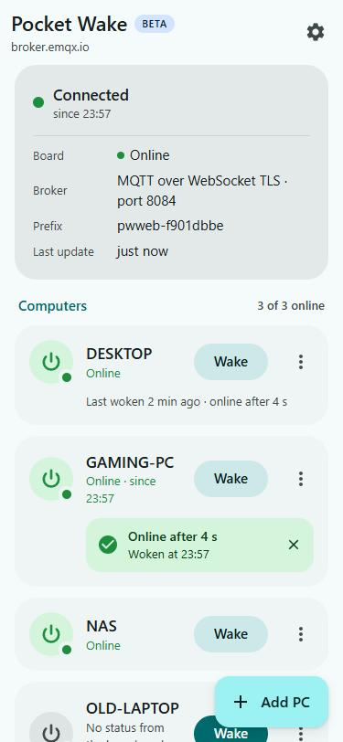

# Pocket Wake

[](https://github.com/joanrra2/pocket-wake/actions/workflows/build.yml)

One-tap Wake-on-LAN for your PCs, from anywhere, through the MQTT bridge of a
[Pocket AdBlock](https://github.com/joanrra2/pocket-adblock) board.

Two ways to use it, same features and look:

- **Android app** (APK): see [Install](#install).
- **Web app for iPhone, iPad and any browser**: open **https://joanrra2.github.io/pocket-wake/** and, on iPhone, tap
  *Share → Add to Home Screen*. Nothing to install from a store.

Pick a PC, tap **Wake**, and watch it come up: the board sends the magic packet on your
home network, checks that the PC answers, and the app shows **Online after 23 s**.

<p>
  
  
  
</p>

## What it shows

- **Connection card**: connected / reconnecting / why it can't connect (wrong password,
  untrusted certificate, wrong port...), whether the **board** is online (its MQTT last
  will), the transport (TLS, port), the topic prefix and when the last update arrived.
- **One card per PC** with a green / grey dot. PCs that have an IP on the board appear by
  themselves; PCs without an IP can be added by name (case-sensitive, e.g. `OFFICE-PC`).
- **Wake progress**: "Waking… 12 s" with a 3-minute progress bar, then
  "Online after N s", "Already online", "Magic packet sent" (PCs the board can't check),
  or a hint when nothing answers after 3 minutes.
  With board firmware 0.6 or later the board reports the result itself: the app follows
  the PC's own wait (set per PC on the board, up to 60 minutes), shows **Cancel** while
  waiting, and also shows wakes started elsewhere (Home Assistant, another phone).
- **Watch-only devices**: a NAS, printer or camera saved on the board without a MAC
  shows its online dot and **Watch only** instead of a Wake button (board firmware 0.6+).
- **Last wake** per PC ("Last woken yesterday · online after 41 s"), kept on the phone.
- **Ad blocking** card: an on/off switch for the board's blocking (turning it off asks
  first) and its stats (queries blocked, blocklist size, devices), updated every minute.
  With board firmware 0.6 or later it also shows how long the board has been up and why
  it last restarted (a crash, the watchdog or a power dip is marked).
  It appears only when the phone's broker login may read `<prefix>/blocking`; see
  [the optional rules](docs/SETUP.md#2-create-the-mqtt-broker).
- **Wake shortcuts** (Android): long-press the app icon for the last woken PCs, or
  *⋮ → Add to home screen* on a PC for its own icon. A shortcut opens the app and wakes
  the PC as soon as the broker connects.
- **Test connection** in settings checks the login and TLS, whether the board is online,
  lists the PCs it reports, and says which topics the broker's access rules refuse,
  before you save.

## Privacy and permissions

- `INTERNET`, plus `CAMERA` only when you tap **Scan** to read the board's setup QR code.
  Frames are decoded on the phone with [ZXing](https://github.com/zxing/zxing) (Apache 2.0):
  no Google services, nothing uploaded. No analytics, no ads, no trackers, no background
  service: the app connects only while it is open and disconnects when you leave it.
- The broker password is encrypted (AES-256-GCM) with a key held in the Android Keystore.
  App backups are disabled.
- TLS is verified against Android's trusted certificate authorities with hostname
  checking. There is no "accept any certificate" option.

## Setup

**Step-by-step guide: [docs/SETUP.md](docs/SETUP.md)**. It covers the PC (BIOS, Windows),
the broker (EMQX Cloud Serverless with separate logins for the board and the phone), the
board's web UI, the app, and troubleshooting.

<p align="center"></p>

<p align="center">110-second walkthrough · <a href="docs/media/wake-setup-en.mp4">MP4</a> · En español: <a href="docs/media/wake-setup-es.gif">GIF</a> · <a href="docs/media/wake-setup-es.mp4">MP4</a></p>

In short:

1. **PC**: wired Ethernet, Wake-on-LAN on in BIOS/UEFI and the network adapter, Windows
   fast startup off.
2. **Broker**: create a TLS broker and **two logins**, one for the board and one for the phone.
3. **Board** (`http://sinkhole.local/`): *Settings → Remote wake (MQTT)*: Broker URI
   `mqtts://<broker>:8883`, the board login, prefix `sinkhole`; restart. Then
   *Wake → Add a computer* with its name, MAC and (for the online dot) its IP.
4. **App**: *Set up broker* → **Scan** the QR code on the board's *Wake-on-LAN → Phone app*
   card (address, port and prefix fill in), then type the **phone** login's password. Or
   fill it in by hand: broker address (host only), port 8883, TLS on, the phone login, the
   same prefix. *Test connection*, *Save*, then **Wake**.

### Topics used

| Topic | Direction | Payload |
|---|---|---|
| `<prefix>/wol/<name>/set` | app → board | `1` (any payload wakes `<name>`; QoS 1, not retained); `cancel` stops waiting (firmware 0.6+, sent only after the board said `waking`) |
| `<prefix>/wol/<name>/result` | board → app | firmware 0.6+, retained: `waking`, `online after 41 s`, `no answer after 3 min`, `cancelled`, `already online`, `watch only` (saved without a MAC: no Wake button)… |
| `<prefix>/wol/<name>/state` | board → app | `online` / `offline` (retained; only PCs with an IP) |
| `<prefix>/status` | board → app | `online` / `offline` (retained, last will) |
| `<prefix>/blocking` | board → app | `ON` / `OFF` (retained), ad blocking |
| `<prefix>/blocking/set` | app → board | `ON` / `OFF` (QoS 1, not retained) |
| `<prefix>/stats` | board → app | JSON every 60 s: `blocked`, `allowed`, `percent`, `domains`, `clients`; firmware 0.6+ adds `uptime` (s) and `restart` (reason) |

The last three are optional: without them the app simply hides the ad-blocking card.

### Automation (Android)

Other apps can ask Pocket Wake to wake a PC; it always asks you to confirm first:

- Intent action `io.github.joanrra2.pocketwake.WAKE` with the string extra `name`
  (Tasker: *Send Intent*, target *Activity*), or
- a link such as `pocketwake://wake/OFFICE-PC` (NFC tags, buttons in other apps).

Only the app's own shortcuts wake without asking.

Problems? See [Troubleshooting](docs/SETUP.md#troubleshooting).

## Web app (iPhone, iPad, any browser)



**https://joanrra2.github.io/pocket-wake/**: a static page (in [`web/`](web/)) published with GitHub Pages. It uses MQTT
over secure WebSocket (EMQX Cloud: port **8084**, path **/mqtt**), because browsers can't
open raw MQTT connections. Same screens and wake flow as the Android app.

- Setup links: the board's QR code is a link to this page (`…/pocket-wake/#setup?host=…`),
  so the iPhone Camera opens it with the broker settings filled in. It never carries a password.
- Add it to the iPhone home screen (*Share → Add to Home Screen*) to get an app icon and
  full-screen view. Android/desktop Chrome offers *Install*.
- Connects only while the page is open. No analytics, no other servers; a strict Content
  Security Policy limits the page to its own files and WebSocket connections.
- The password is saved only if you tick *Remember*, encrypted with a non-extractable
  browser key. That's weaker than the Android Keystore (the key lives in the same browser
  profile, and the page shares the `joanrra2.github.io` origin), so use a separate phone
  login that can only wake PCs.
- MQTT library: [MQTT.js](https://github.com/mqttjs/MQTT.js) 5.16.1 (MIT), vendored in
  `web/vendor/`.

Develop: serve `web/` with any static server (`python -m http.server -d web 8765`) and run
the unit tests with `node --test` inside `web/`.

## Install

- **Debug builds**: every push builds `pocket-wake-debug-<n>`, under *Actions → Build →
  Artifacts* (unzip it to get the APK).
- **Releases**: tags `v*` publish a signed APK on the *Releases* page. Tags with a
  suffix, such as `v0.3.0-rc.1`, are marked as pre-releases.

Allow "Install unknown apps" for your browser or file manager when Android asks.
Debug and release builds install side by side (the debug one is "Pocket Wake (debug)").

## Build

Requirements: JDK 17+ (21 recommended) and the Android SDK (platform 37).

```bash
./gradlew testDebugUnitTest assembleDebug
```

The APK is at `app/build/outputs/apk/debug/app-debug.apk`. To install it on a phone with
USB debugging enabled:

```bash
adb install -r app/build/outputs/apk/debug/app-debug.apk
```

Other tasks:

```bash
# End-to-end MQTT test against the public test broker broker.emqx.io (random topics, cleaned up afterwards)
POCKETWAKE_IT=1 ./gradlew testDebugUnitTest --tests '*BrokerIntegrationTest*'

# Re-render the README screenshots (docs/screenshots) with Robolectric
./gradlew recordRoborazziDebug

# Release APK (unsigned unless the signing variables below are set)
./gradlew assembleRelease
```

### Release signing

Signing keys are never stored in the repository. The release build reads them from
environment variables, which the GitHub workflow fills from repository secrets:

| Secret | Value |
|---|---|
| `POCKETWAKE_KEYSTORE_BASE64` | your upload/release keystore (`.jks`), base64-encoded |
| `POCKETWAKE_KEYSTORE_PASSWORD` | keystore password |
| `POCKETWAKE_KEY_ALIAS` | key alias |
| `POCKETWAKE_KEY_PASSWORD` | key password |

Create the keystore yourself (for example with `keytool -genkeypair -v -keystore
release.jks -keyalg RSA -keysize 4096 -validity 10000 -alias pocketwake`), keep a backup
somewhere safe (losing it means users must uninstall to update), and add the secrets
under *Settings → Secrets and variables → Actions*. Base64 for the first secret:
`base64 -w0 release.jks` (Linux) or
`[Convert]::ToBase64String([IO.File]::ReadAllBytes("release.jks"))` (PowerShell).

Then push a tag:

```bash
git tag v0.3.0 && git push origin v0.3.0
```

To sign locally instead, set `POCKETWAKE_KEYSTORE_FILE` (a path) and the three
password/alias variables before `./gradlew assembleRelease`.

## How it works

- Android: Kotlin, Jetpack Compose (Material 3, dynamic colour on Android 12+), minSdk 26.
- Web: plain HTML/CSS/JavaScript modules, no build step; `web/js/core.js` mirrors the
  Android `core/` logic and has its own unit tests.
- MQTT 3.1.1 with the [HiveMQ MQTT Client](https://github.com/hivemq/hivemq-mqtt-client)
  (Apache-2.0); reconnects with backoff (1 → 30 s) on network errors, stops on login or
  certificate errors.
- The connection follows the app's foreground state (`ProcessLifecycleOwner`), so rotating
  the phone doesn't reconnect.
- Code layout: `core/` pure Kotlin (topics, the host and wake state machine, formatting;
  unit-tested), `mqtt/` broker session and connection test, `data/` settings and the
  Keystore-encrypted password, `ui/` Compose screens.

See [ROADMAP.md](ROADMAP.md) for what's planned next.
