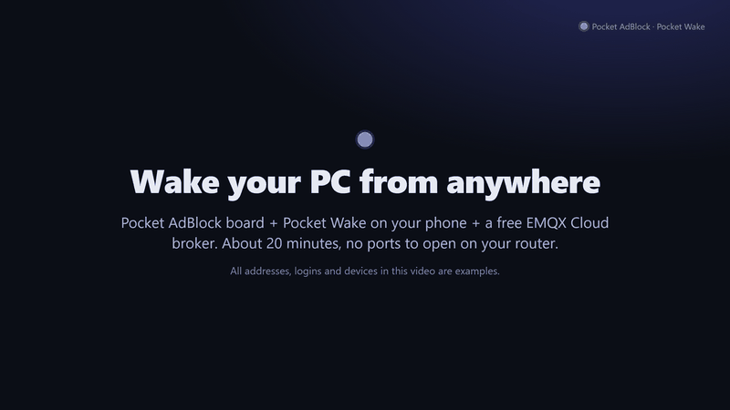

# Setup guide: from zero to waking your PC from your phone

> **Pocket Wake is in beta.** It works end to end, but expect rough edges. Please report
> problems in [Issues](https://github.com/joanrra2/pocket-wake/issues).

About 20 minutes the first time. Prefer to watch first? Here is the whole setup in under
two minutes ([MP4](media/wake-setup-en.mp4); en español: [GIF](media/wake-setup-es.gif) ·
[MP4](media/wake-setup-es.mp4)). Every address, login and device in it is an example.

<p align="center"></p>

You need:

- a Pocket AdBlock board already running on your home network (firmware **0.4.3 or
  newer** for the setup QR code; older firmware works too, you then type the settings),
- a PC on **wired Ethernet** (Wake-on-LAN over Wi-Fi almost never works),
- a phone: **Android** 8.0 or newer (the app), or an **iPhone / iPad** or any other device with
  a modern browser (the web app),
- a free MQTT broker account (this guide uses **EMQX Cloud Serverless**; any MQTT broker
  with TLS works).

## How the pieces talk

```
 Phone (Pocket Wake) ──TLS──▶  MQTT broker (cloud)  ◀──TLS── Pocket AdBlock board ──magic packet──▶ PC
        publishes  sinkhole/wol/<PC>/set           the board subscribes and wakes <PC>
        listens to sinkhole/wol/<PC>/state  ◀──── the board reports online / offline
```

Both the phone and the board connect **out** to the broker, so you don't open any port on
your router and the phone works from anywhere (mobile data, other Wi-Fi).

The checklist, in order:

1. [Prepare the PC for Wake-on-LAN](#1-prepare-the-pc)
2. [Create the broker and two logins](#2-create-the-mqtt-broker)
3. [Connect the board to the broker](#3-connect-the-board)
4. [Add the PC on the board](#4-add-the-pc-on-the-board)
5. [Install and set up the app](#5-install-and-set-up-the-app): [Android](#5a-android-app) or
   [iPhone / any browser](#5b-iphone-ipad-or-any-browser-web-app)
6. [Wake it](#6-wake-it)

---

## 1. Prepare the PC

Do this once per PC. Menu names vary by manufacturer.

**BIOS / UEFI** (press Del, F2 or F10 while the PC starts):

- Enable **Wake on LAN**. It can also be called *Power On By PCI-E*, *Resume by LAN*,
  *PME Event Wake Up* or *Remote Wake Up*.
- If there is an **ErP / EuP** or *Deep Sleep* option, **disable** it: it cuts power to
  the network card when the PC is off.

**Windows**:

1. *Device Manager → Network adapters →* your **Ethernet** adapter *→ Properties*:
   - *Power Management*: tick **Allow this device to wake the computer** and
     **Only allow a magic packet to wake the computer**.
   - *Advanced*: set **Wake on Magic Packet** to *Enabled* (and *Shutdown Wake-On-Lan* if
     it's listed).
2. *Control Panel → Power Options → Choose what the power buttons do → Change settings
   that are currently unavailable*: **untick "Turn on fast startup"**. With fast startup on,
   many PCs don't wake after *Shut down* (they still wake from *Sleep*).
3. Note two things from `ipconfig /all` (Ethernet adapter section):
   - **Physical Address**, e.g. `A8-5E-45-12-34-56`: the MAC address.
   - **IPv4 Address**, e.g. `192.168.1.40`.

**Router** (recommended): give the PC a fixed IP (*DHCP reservation* / *static lease*) so
its address doesn't change. The board uses the IP to tell whether the PC is online.

Quick test: shut the PC down, check that the Ethernet port LEDs stay lit, and continue.

## 2. Create the MQTT broker

The steps below are for EMQX Cloud Serverless, which is free for this use. The menu names
are the ones in EMQX's documentation in November 2026; the console changes now and then,
so they may differ slightly.

1. Sign up at [emqx.com](https://www.emqx.com/en/cloud) (**Start Free**) and open the
   **Cloud Console**. The first time, it asks you to create a **project**: any name.
2. **New Deployment → Serverless**:
   - **Spend Limit**: leave it at **0**. The deployment then only uses the free monthly
     quota: 1 million session minutes and 1 GB of traffic, of which a board and a phone
     use a small fraction.
   - Give it a **Deployment Name**, accept the Serverless terms and click **Deploy**.
     After about a minute its status says **Running**.
3. Open the deployment's **Overview**. Under **Connection Information**, note:
   - **Address**, e.g. `x1a2b3c4.ala.eu-central-1.emqxsl.com` (yours is different)
   - **MQTT over TLS port**: `8883` (the board and the Android app use this one)
   - **WebSocket over TLS port**: `8084`, path `/mqtt` (the web app uses this one)

   Serverless only accepts encrypted connections (8883 and 8084); plain 1883 doesn't
   exist there. No certificate needs downloading: EMQX Cloud's certificate chains to
   *DigiCert Global Root G2*, which the board, Android, iOS and every current browser
   already trust.
4. **Access Control → Authentication → + Add**. Create **two** logins, one for each
   device, and **Confirm** each:

   | Username (example) | Used by | Password |
   |---|---|---|
   | `pocket-board` | the board | a long random one |
   | `pocket-phone` | the phone app or web app | a different long random one |

   Separate logins mean you can change or revoke the phone's access without touching the
   board, and the phone never holds the board's password. Keep both passwords in your
   password manager: you type each one only once. (Serverless has no anonymous access, so
   every device needs a login.)

5. *Optional hardening: limit each login to its topics.* Under **Access Control →
   Client Authorization**, on the **Username** tab, **+ Add** these rules with
   permission **Allow** (`sinkhole` is the default prefix; use yours):

   | Username | Action | Topic |
   |---|---|---|
   | `pocket-board` | Publish & Subscribe | `sinkhole/#` |
   | `pocket-board` | Publish | `homeassistant/#` (only if you use Home Assistant) |
   | `pocket-phone` | Publish | `sinkhole/wol/+/set` |
   | `pocket-phone` | Subscribe | `sinkhole/wol/+/state` |
   | `pocket-phone` | Subscribe | `sinkhole/status` |
   | `pocket-phone` | Subscribe | `sinkhole/blocking` *(optional, ad-blocking card)* |
   | `pocket-phone` | Subscribe | `sinkhole/stats` *(optional, ad-blocking card)* |
   | `pocket-phone` | Publish | `sinkhole/blocking/set` *(optional, ad-blocking switch)* |
   | `pocket-phone` | Subscribe | `sinkhole/wol/+/result` *(optional, wake results and Cancel; board firmware 0.6+)* |

   Leave out the three ad-blocking rules if the phone should only wake PCs: the app then
   hides the ad-blocking card. Without the `result` rule the app waits the default
   3 minutes and shows no Cancel button. **Test connection** lists any topic the rules
   refuse.

   Then, on the **All Users** tab, add topic `#`, action **Publish & Subscribe**,
   permission **Deny**. EMQX allows anything that no rule matches, so the rules above only
   restrict anything once this catch-all deny is in place. A login that can't subscribe
   shows up in the app as "No board status" and an empty list of PCs.

Good to know: EMQX stops a Serverless deployment that has had no client connected for 30
days in a row. With the board online that never happens; if it does, start it again from
the console.

## 3. Connect the board

1. Open the board's web page: **http://sinkhole.local/** (or its IP address) and sign in.
2. **Settings → Remote wake (MQTT)**:
   - **Broker URI**: `mqtts://<your address>:8883`, e.g.
     `mqtts://x1a2b3c4.ala.eu-central-1.emqxsl.com:8883`
   - **User** / **Password**: the **board** login (`pocket-board`)
   - **Topic prefix**: leave `sinkhole` (or choose your own and use the same in the app)
   - *Show in Home Assistant* is optional and doesn't affect the app.
   - **Save**.
3. The MQTT settings apply after a restart: **Updates → Restart device**.
4. After about 30 s, open **Wake**. The *Wake from anywhere* card should say
   **Broker connected**. If it says *Broker not connected*, check the URI (`mqtts://`,
   port 8883) and the board login.

## 4. Add the PC on the board

**Wake → Add a computer**:

| Field | Example | Notes |
|---|---|---|
| Name | `OFFICE-PC` | This exact name is used in the app. **Case-sensitive**, no `/ + #`. |
| MAC address | `a8:5e:45:12:34:56` | From `ipconfig /all`; dashes or colons both work. |
| IP address | `192.168.1.40` | Optional, but needed for the green/grey online dot and for "Online after N s". |
| Port to check | `3389` | Optional. A port the PC answers on when it's up: 3389 for Remote Desktop, 22 for SSH. |

Save, shut the PC down, and press **Wake** on the board's page once. If the PC doesn't
start, fix that first (step 1): the app uses exactly the same wake.

## 5. Install and set up the app

Both versions do the same thing and can be used side by side with the same phone login.

### 5a. Android app

1. **Get the APK**:
   - *Releases* page of this repository (signed builds, once one is published), or
   - *Actions → Build →* latest run *→ Artifacts → pocket-wake-debug-…* (a zip containing
     the debug APK; you need to be signed in to GitHub to download it), or
   - build it yourself (see the README).
2. Open the APK on the phone. If Android asks, allow **Install unknown apps** for the
   browser or file manager you used.
3. Open **Pocket Wake → Set up broker**. The quickest way: on a computer, open the
   board's web page → **Wake-on-LAN** → **Phone app** card, type the phone's username
   (`pocket-phone`) there, and tap **Scan** in the app (allow the camera when asked). The
   address, port, TLS, username and prefix fill in; type the password. The QR code never
   contains a password. Or fill everything in by hand:
   - **Address**: the broker address **only**, e.g. `x1a2b3c4.ala.eu-central-1.emqxsl.com`
     (no `mqtts://`, no port)
   - **Port** `8883`, **TLS** on
   - **Username** / **Password**: the **phone** login (`pocket-phone`)
   - **Topic prefix**: same as on the board (`sinkhole`)
4. Tap **Test connection**. A good result shows:
   - ✅ *Connected in … ms*: TLS certificate verified, login accepted
   - ✅ *Board online*: `sinkhole/status = online`
   - ✅ *Found 1 PC: OFFICE-PC (offline)*

   PCs only appear here when they have an IP on the board. Without one, add them by name
   on the home screen (**Add PC**).
5. Tap **Save**. The home screen shows *Connected*, *Board: Online*, and a card for each PC.

The password is stored encrypted with a key that never leaves the phone's Android
Keystore. The app connects only while it's open, so it uses no battery in the background.

### 5b. iPhone, iPad or any browser (web app)

1. Open **https://joanrra2.github.io/pocket-wake/** in Safari (iPhone/iPad) or any current browser.
2. iPhone/iPad: tap **Share → Add to Home Screen**. Pocket Wake then gets its own icon and
   opens full-screen like an app. (Chrome on Android or desktop offers **Install** instead.)
3. Quickest: point the iPhone **Camera** at the QR code on the board's **Wake-on-LAN →
   Phone app** card (on a computer) and tap the link. Pocket Wake opens with the address,
   port 8084, path and prefix filled in; type the password. If you added Pocket Wake to the
   home screen before scanning, check its settings too: some iOS versions keep home-screen
   apps' storage apart from Safari's.

   Or tap **Set up broker** and fill in:
   - **Address**: the broker address **only**, e.g. `x1a2b3c4.ala.eu-central-1.emqxsl.com`
   - **Port** `8084` and **Path** `/mqtt` (WebSocket over TLS; browsers can't use 8883)
   - **Username** / **Password**: the **phone** login (`pocket-phone`)
   - **Remember the password on this device**: leave it ticked on your own phone; untick
     it on a shared device and you'll type the password each time.
   - **Topic prefix**: same as on the board (`sinkhole`)
4. **Test connection**, then **Save**, exactly as in the Android app.

About the web app's storage: settings stay in this browser only. The password is
encrypted with a key the browser generates and refuses to export, but it lives in the
same browser profile as the page, so it's less protected than the Android Keystore. Using
a separate phone login that can only wake PCs keeps the risk small. *Forget this device*
in settings erases everything.

## 6. Wake it

Tap **Wake** on the PC's card:

1. *Sending wake request…*: the phone publishes to `sinkhole/wol/OFFICE-PC/set`.
2. *Waking… 12 s*: the board sent the magic packet and is checking the PC.
3. ✅ **Online after 23 s**: the board saw the PC answer.

Other results:

| You see | Meaning |
|---|---|
| Already online | The PC was already up; the request was sent anyway. |
| Magic packet sent | The PC has no IP on the board, so it can't confirm. Check the PC itself. |
| No answer after 3 min | The board sent the packet but the PC didn't come up: see step 1. If it boots later, the card still switches to "Online after …". |
| Couldn't send | The phone lost the broker connection. Check the connection card at the top and tap Retry. |

Then connect to the PC with Remote Desktop, RustDesk, AnyDesk, Parsec…

---

## Troubleshooting

**The app**

| Message | Fix |
|---|---|
| Wrong username or password | Use the **phone** login; re-type the password (Show reveals it). |
| Login refused: check … access rules | A Client Authorization rule blocks the phone login (step 2.5). |
| The broker closed the connection. Is port … a TLS port? | Android app: port 8883 with TLS **on**. Port 1883 is plain MQTT (not available on EMQX Serverless). |
| Can't reach wss://… (web app) | Port 8084 and path `/mqtt` for EMQX Cloud; check the address. Browsers don't say which part failed. |
| Can't find `<host>` | Typo in the address, or no internet on the phone. |
| The broker's TLS certificate isn't trusted / doesn't match | Use the host name from the EMQX overview, not an IP address. |
| No board status under `sinkhole/status` | The prefix differs between board and app, the board isn't connected (step 3.4), or the phone login can't subscribe to `sinkhole/status`. |
| The broker won't let this login read … | A Client Authorization rule refuses that topic to the phone login (step 2.5). |
| Ad-blocking switch not allowed (optional) | The phone login may only wake PCs. Add the three optional rules in step 2.5 to get the switch and stats. |
| Wake results not allowed (optional) | Add the `sinkhole/wol/+/result` rule in step 2.5 to get the board's own results and Cancel (board firmware 0.6+). |
| The board didn't confirm (ad blocking) | The phone login can't publish `sinkhole/blocking/set` (step 2.5), or the board went offline. |
| Board offline | The broker holds the board's "last will": it lost Wi-Fi or power. Wake requests wait until it reconnects. |
| No PCs reported | Add an IP to the PC on the board, or add it by name in the app. |

**The PC doesn't wake** (the board's own Wake button doesn't work either)

- Ethernet cable, not Wi-Fi; port LEDs lit while the PC is off.
- Fast startup off, ErP/EuP off, Wake on LAN on in BIOS **and** in the adapter settings.
- Some PCs only wake from *Sleep*, not from *Shut down*. Try *Sleep* first.
- After a power cut, many PCs need one normal start before Wake-on-LAN works again.

**Seeing the messages yourself**

Use a desktop MQTT client such as [MQTTX](https://mqttx.app/) (the one EMQX's docs
suggest). Connect to your address on port 8883 with TLS on and the **phone** login,
subscribe to `sinkhole/#`, and you'll see `sinkhole/status`, the PC states, and your wake
requests as they happen. (With the optional rules from step 2.5, the phone login only sees
the topics it needs; that's expected.)

## What the app sends and receives

| Topic | Direction | Payload |
|---|---|---|
| `<prefix>/wol/<name>/set` | app → board | `1`, QoS 1, not retained (any payload wakes); `cancel` stops waiting (firmware 0.6+) |
| `<prefix>/wol/<name>/result` | board → app | last wake result, retained (firmware 0.6+) |
| `<prefix>/wol/<name>/state` | board → app | `online` / `offline`, retained, only for PCs with an IP |
| `<prefix>/status` | board → app | `online` / `offline`, retained; `offline` is the board's last will |

Nothing else is sent: no analytics, no other servers.
